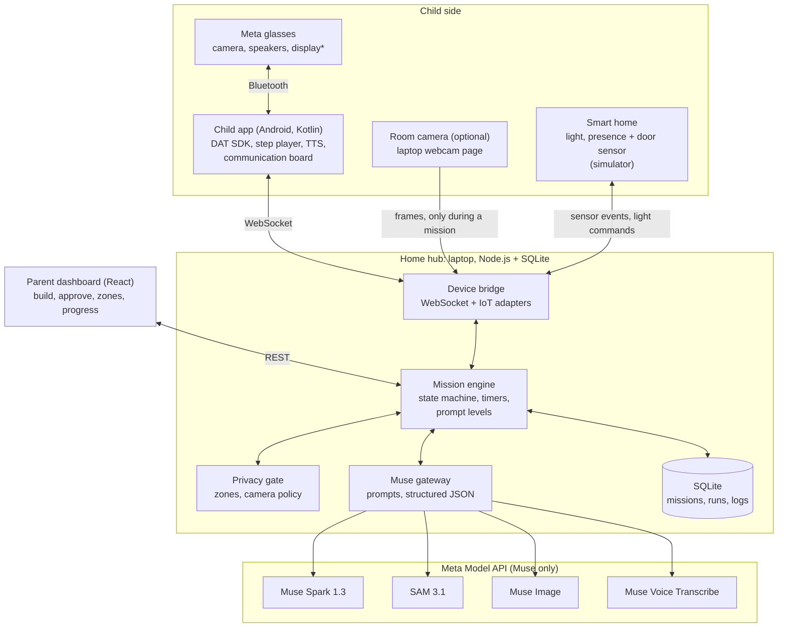
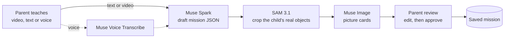
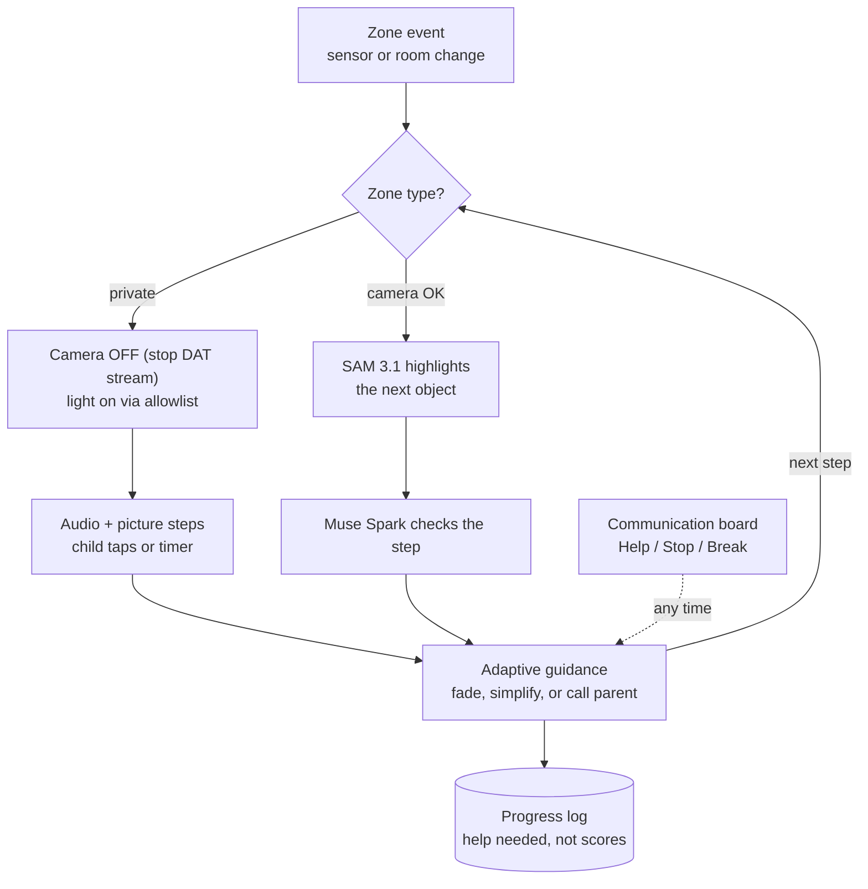
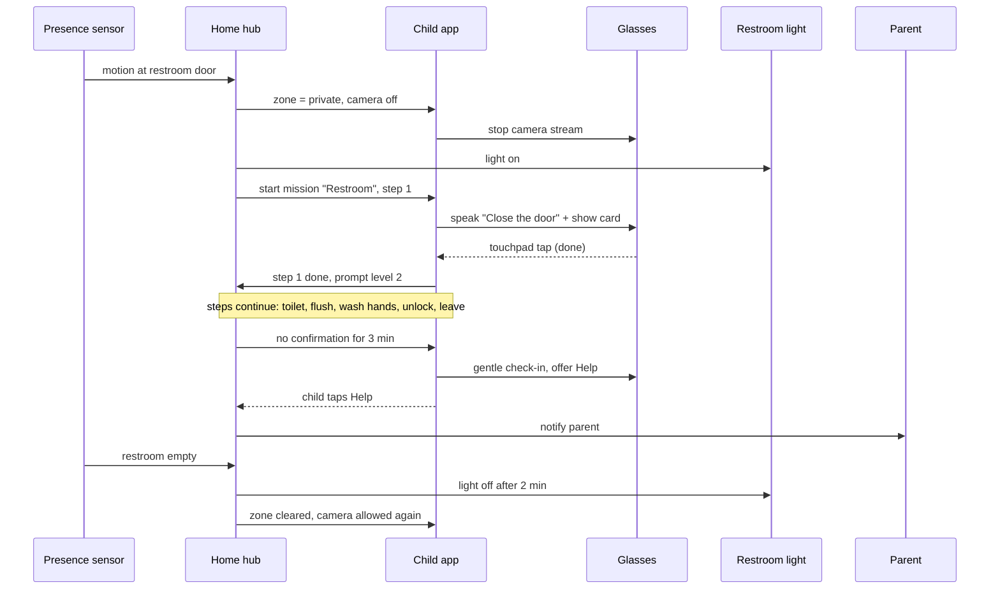
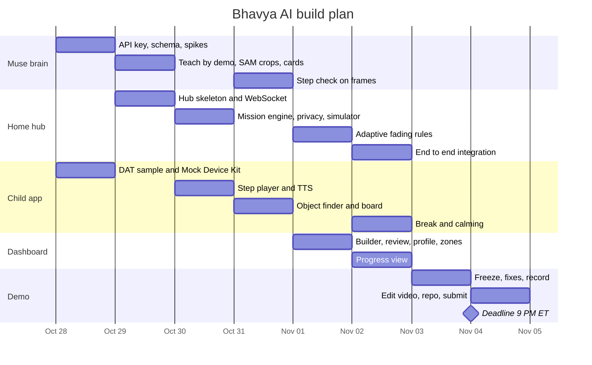

# Bhavya AI — Build Plan

AI-powered independence companion for autistic children, built for the **Meta Global AI Developer Hackathon** (Oct 26 – Nov 4, 2026).

| | |
|---|---|
| Submission deadline | **Wed Nov 4, 9:00 PM ET** (= 02:00 UTC Nov 5; US clocks change on Nov 1) |
| Days left at plan time | 8 (Oct 28 → Nov 4) |
| AI rule | Use only Meta models: Muse family via Meta Model API (no external LLMs) |
| Source requirements | `Bhavya AI — AI-Powered Independence Companion` (Google Doc) |
| Build status (Oct 28) | Hub, parent dashboard, web child app and home simulator built and tested against the live Muse API. Android glasses app (Kotlin, DAT 1.0.1) built; not yet tested on a phone (see android/README.md) |

---

## 1. Scope for the hackathon

The full requirements doc is months of work. For the hackathon we build **all five core MVP capabilities (§5 of the doc) in simple form** and demo **two missions end to end**:

| Demo mission | Room type | What it shows |
|---|---|---|
| **Restroom independence** | Private, camera **off** | Presence sensor, auto light, audio + picture steps, tap confirmations, timers, privacy gate |
| **Pack school bag** | Camera allowed | Teach by demonstration, SAM 3.1 highlights the next object, Muse Spark checks each step, prompt fading |

**Out of scope for the hackathon:** the sensory/emotional roadmap (doc §6), automatic safety-concern detection (doc §4), any medical or therapeutic claims.

---

## 2. Hackathon rules: known vs. to verify

**Confirmed on public pages** ([event page](https://cerebralvalley.ai/e/meta-ai-developer-hackathon), [Meta page](https://dev.meta.ai/events/global-hackathon)):
- Deadline Nov 4, 9 PM ET. Judging Nov 4–8. Finals and winners Nov 9.
- Models: Muse Spark series, Muse Wonder, Muse Image, SAM 3.1 via Meta Model API; Meta open-weight models; Muse Code.
- Indie track: creativity, technical ambition, does it work. Startup track: technical execution, production readiness.

**From an unofficial participant repo** ([meta-ai-hackathon/meta-hack](https://github.com/meta-ai-hackathon/meta-hack)), still to be checked:
- 3-minute demo video is the main judging item, plus a **public repo**. Teams of up to 4, one submission per team, new work only.
- Pass/fail gate: the project must really use the Meta Model API or open-weight models.
- Rubric: Impact 30%, Meta AI tooling 25%, Demo 25%, Technical depth 20%. Top 5 per track go to a live final.
- Disqualified project types include "AI medical advice", "simple image analyzers", and "machines judging people".
- Bonus prizes that fit Bhavya: Best Agentic Use-Case ($5K), Best Creative Build with Muse Image ($5K), Most Viral ($20K, X post engagement).

**To verify in the login-only participant guide** (<https://cerebralvalley.ai/e/meta-ai-developer-hackathon/details>):
- [ ] Exact submission format (video length, repo, write-up, where to submit)
- [ ] Is the on-device Android TextToSpeech allowed? (Muse has no text-to-speech model)
- [ ] Full restriction list
- [ ] How to claim API credits (claim deadline is also Nov 4)

---

## 3. Requirements → build decisions

| Requirement (doc section) | Decision | How |
|---|---|---|
| Teach by instructions (§1) | **Build** | Parent types or speaks → Muse Voice (speech) → Muse Spark → mission JSON |
| Teach by demonstration (§1) | **Build** | Parent records a short video → Muse Spark (video input) → steps + objects. SAM 3.1 crops real objects |
| Tasks, expected actions, checks, safety, alternatives (§1) | **Build** | Fields in the mission JSON (§9). Parent approves before use |
| Personalize to the child (§1) | **Build (simple)** | Child profile: language, reading level, voice vs. pictures, sound level |
| Guidance via glasses / earpiece / phone / display (§2) | **Build** | Glasses speakers or phone. Ray-Ban Display screen if available, else phone screen |
| SAM 3.1 recognizes and highlights objects (§2) | **Build** | Camera-OK rooms only, and only when the current step needs an object |
| Muse Spark interprets observations, gives guidance (§2) | **Build** | Step check on frames + pre-generated guidance |
| Checks steps, notices when help is needed (§2) | **Build** | Vision check (camera rooms), tap/timer (private rooms), Help button |
| Simpler explanation / picture / reminder when stuck (§2) | **Build** | Pre-generated at authoring time, so it works with no camera and no network delay |
| Adaptive prompting, fade reminders (§2) | **Build** | Prompt levels in the mission engine (§8) |
| Restroom: presence sensor, auto light (§3) | **Simulate** | Smart-home simulator page. Real sensor via Home Assistant is optional |
| No camera in private spaces (§3) | **Build** | Privacy gate stops the app's glasses camera stream in private zones |
| Door lock never automated (§3) | **Design rule** | There is no lock/unlock action in the code at all. Only spoken reminders |
| Living-room camera, privacy-preserving (§4) | **Optional** | Laptop webcam page, only active while a mission runs in that room |
| Detect safety concerns (§4) | **Later** | Too risky to do well in 8 days |
| Calming music / breathing / sensory break on request (§4) | **Build (simple)** | Break button → options the child picked in their profile |
| Stimming must not be treated as abnormal (§4) | **Design rule** | Muse is never asked about the child's body, face, emotions or movements |
| Child can dismiss, ask for help, turn off assistance (§4) | **Build** | Communication board: Help, Stop, Break, plus a "pause assistant" toggle |
| Visual routine builder (§5) | **Build** | Authoring flow (§6) |
| AI object finder (§5) | **Build** | SAM 3.1 highlight overlay |
| Communication board (§5) | **Build** | Picture grid + one-tap requests, spoken with TTS, sent to parent |
| Adaptive guidance engine (§5) | **Build** | Mission engine (§8) |
| Parent dashboard (§5) | **Build** | Build, approve, permissions/zones, progress |
| Sensory and emotional regulation roadmap (§6) | **Later** | Keep out of the demo. It is close to the "medical advice" ban |

---

## 4. Architecture



\* The display is only on Meta Ray-Ban Display glasses. Without glasses, use the **Mock Device Kit** on a real Android phone (phone camera or a recorded video acts as the glasses camera).

### Components

| Component | Runs on | Responsibility |
|---|---|---|
| **Child app** | Android phone (+ glasses) | DAT camera session, frame sampling, step player (voice + card + highlight), Android TTS, communication board, tap confirmations, obeys camera on/off from the privacy gate |
| **Home hub** | Laptop (Node.js) | The single source of truth. Runs missions, enforces privacy, calls Muse, talks to devices |
| ↳ Mission engine | hub | Deterministic state machine: current step, timers, prompt level, escalation, allowlisted actions |
| ↳ Privacy gate | hub | Zone table (private / camera OK), camera policy, frame policy (no storage, downscale) |
| ↳ Muse gateway | hub | All Muse calls: prompt templates, JSON schemas, retries, rate limiting |
| ↳ Device bridge | hub | WebSocket to app / dashboard / observer, IoT adapters (simulator, optional Home Assistant) |
| **Parent dashboard** | Browser | Mission builder (video / text / voice), review and approve, child profile, zones, progress |
| **Smart home simulator** | Browser (dashboard page) | Buttons for restroom motion, door open/close, light state |
| **Room observer** (optional) | Browser on laptop | Webcam frames for the living room, only while a mission is active there |

---

## 5. Key design decisions

1. **The laptop is the home hub.** All logic is in one Node.js + SQLite server. Every device connects to it over Wi-Fi. No models run locally, so it works on an 8 GB laptop. In a real home this could be a mini-PC or a cloud server.
2. **Muse drafts, the mission engine decides.** The engine is plain code, not AI. Muse never controls devices directly. The engine only runs actions from a fixed allowlist: `light_on`, `light_off`, `play_audio`, `notify_parent`. There is no `lock` / `unlock` action anywhere, so "door lock never automated" is guaranteed by design.
3. **Generate guidance at authoring time.** When the parent saves a mission, Muse writes 3 prompt levels, a simpler "if stuck" hint and a picture card for every step. At runtime in private rooms there is **no camera and no AI call**. Steps play from stored content.
4. **Privacy gate.** Every zone is `private` or `camera_ok` (parent-configurable). In a private zone the app stops its glasses camera stream and refuses to restart it until the zone is left. Frames are never stored, are downscaled (~512 px) before sending, and are sent only when needed. Never use the `-contributor` model variants (Meta may train on that data). Limitation to state honestly: the app can stop *its own* camera stream, not the glasses' own capture button.
5. **Measure help needed, not obedience.** The log records the prompt level each step needed, Help taps and step time. No points, stars or compliance scores. Muse is never asked to describe or judge the child.

---

## 6. Mission authoring flow (Visual Routine Builder)



- **Teach by demonstration:** the parent records 30–90 s with the glasses or phone, narrating as they go. The video (or 1 frame every 2 s, max 50 images per request, as a fallback) plus the narration transcript go to Muse Spark, which returns steps, objects and key-frame times.
- **Teach by instructions:** typed or spoken steps → Muse Spark → the same mission JSON.
- **Pictures:** for each step object, SAM 3.1 cuts the object out of a demo frame. The parent chooses between the real-object photo and a Muse Image card (generated or edited from the real crop).
- **Parent approval is mandatory.** AI output is a draft until the parent approves it.

---

## 7. Mission runtime and privacy split



### Restroom mission sequence



---

## 8. Adaptive prompting rules

| Level | What the child gets |
|---|---|
| 3 | Full voice instruction + picture card + object highlight (camera rooms) |
| 2 | Short voice instruction + picture card |
| 1 | Chime + picture card |
| 0 | No prompt. The child just confirms when done |

- New missions start at level 3 (parent can change).
- **Fade:** after 3 runs in a row where a step was done without help, drop that step one level.
- **Escalate:** if the step timer runs out or the child taps Help, go up one level and play the `if_stuck` hint.
- **Call a human:** if still stuck after escalation, notify the parent.
- The child can always pause, stop or take a break. The parent can override any level.

---

## 9. Mission JSON

```json
{
  "id": "school-bag-v1",
  "title": "Pack school bag",
  "zone": "living_room",
  "camera": "allowed",
  "trigger": { "type": "manual_or_schedule", "time": "07:30" },
  "steps": [
    {
      "id": "pencil-case",
      "action": "Put the pencil case in the bag",
      "object": "pencil case",
      "prompts": {
        "full": "Find your blue pencil case. Put it in your bag.",
        "short": "Pencil case in bag.",
        "cue": "chime"
      },
      "card": "cards/school-bag/pencil-case.png",
      "check": { "type": "vision", "expect": "pencil case inside the bag" },
      "timeout_s": 60,
      "if_stuck": "Look on the table. It is blue.",
      "safety": []
    }
  ]
}
```

```json
{
  "id": "restroom-v1",
  "title": "Using the restroom",
  "zone": "restroom",
  "camera": "off",
  "trigger": { "type": "zone_enter", "zone": "restroom" },
  "on_start": [{ "action": "light_on", "device": "restroom_light" }],
  "on_end": [{ "action": "light_off", "device": "restroom_light", "delay_s": 120 }],
  "steps": [
    {
      "id": "close-door",
      "action": "Close the door",
      "prompts": {
        "full": "Close the door. Push it until it clicks.",
        "short": "Close the door.",
        "cue": "chime"
      },
      "card": "cards/restroom/close-door.png",
      "check": { "type": "tap" },
      "timeout_s": 45,
      "if_stuck": "The door is behind you. Push it gently.",
      "safety": ["Lock is optional and only by the child", "Never lock automatically"]
    }
  ]
}
```

**Zones (defaults, parent-configurable):**

| Zone | Type | Camera |
|---|---|---|
| restroom | private | off |
| bedroom | private (getting dressed) | off |
| living_room | camera_ok | glasses + optional room camera |
| kitchen | camera_ok | glasses |

---

## 10. Muse usage

Base URL `https://api.meta.ai/v1`, bearer auth with `MODEL_API_KEY`. Images go as `input_image` (base64 data URL) in the Responses API. Up to 50 images per request. Grounding coordinates use a 0–1000 grid.

| Model | ID | Used for |
|---|---|---|
| Muse Spark 1.3 | `muse-spark-1.3` | Mission from text / demo video, personalization, step check on frames, authoring agent |
| SAM 3.1 | `sam-3.1` | Highlight the next object (text prompt = `step.object`), crop real objects from demo frames |
| Muse Image | `muse-image-1.0` | Picture cards and board icons (`/v1/images/generations`, `/v1/images/edits`) |
| Muse Voice Transcribe | `muse-voice-transcribe-1.0` | Parent narration and spoken instructions, optional child "help" / "done" |
| Text-to-speech | none in Muse | Android `TextToSpeech` on the phone (confirm with organizers) |

**Prompt templates** (in `shared/prompts/`):

| Template | Input | Output |
|---|---|---|
| `mission_from_text` | instructions + child profile | mission JSON |
| `mission_from_demo` | video or frames + narration transcript + child profile | mission JSON + object list + key-frame times |
| `personalize_prompts` | step + child profile | `full` / `short` / `if_stuck` wording |
| `step_check` | frame + `step.expect` + `step.object` | `{ done, confidence, object_visible, hint }` |

Rules for every vision prompt: describe objects and task state only. Never describe the child's body, face, emotions or movements.

**To verify on Day 1:** exact request formats for SAM 3.1 and Muse Voice Transcribe, video input limits for Muse Spark, structured output syntax, rate limits and credit balance.

---

## 11. Privacy and safety checklist

- [ ] Private zones stop the app's camera stream. Restart is blocked until the zone is left
- [ ] No frames written to disk anywhere (hub, app, dashboard)
- [ ] Frames downscaled before sending. Sent only on step checks or object finding
- [ ] No `-contributor` model variants
- [ ] No lock/unlock action exists in code. Only allowlisted IoT actions
- [ ] Vision prompts never ask about the child's body, face, emotions or movements
- [ ] Every AI-made mission needs parent approval
- [ ] Child can pause, stop, take a break or turn off assistance at any time
- [ ] Progress shows help needed, never scores or compliance
- [ ] Demo and README avoid medical or therapy claims

---

## 12. Tech stack and repo layout

| Part | Stack |
|---|---|
| Home hub | Node.js 22 + TypeScript, Fastify (REST) + `ws` (WebSocket), SQLite, zod schemas |
| Parent dashboard | React + Vite + TypeScript (includes simulator and observer pages) |
| Child app | Kotlin, Jetpack Compose, Meta Wearables Device Access Toolkit, Android `TextToSpeech`, OkHttp WebSocket |
| Shared | `mission.schema.json` (also used for Muse structured output), prompt templates |

```
bhavya-ai-app/
  PLAN.md          this file
  hub/             Node.js home hub
    src/engine/    mission state machine, prompt levels
    src/privacy/   zones, camera policy
    src/muse/      Muse gateway: prompts, schemas, client
    src/bridge/    WebSocket + IoT adapters (simulator, Home Assistant)
    src/db/        SQLite
  dashboard/       React: builder, review, profile, zones, progress, simulator, observer
  android/         Kotlin child app (DAT SDK)
  shared/          mission.schema.json, prompts/
  demo/            seed missions, demo videos, video script
```

---

## 13. Hardware and dev environment

| Item | Status / note |
|---|---|
| Laptop | i7-1165G7, 7.7 GB RAM, Intel Iris Xe. Fine for hub + dashboard. Node 22, Java 17 installed |
| Android Studio | Not installed yet. Works on 8 GB but close the browser while building |
| Android emulator | **Don't use** (too heavy with 8 GB). Use a real phone over USB |
| Android phone | Required. Android 10+ |
| Meta glasses | Optional. Without them, use the Mock Device Kit on the phone |
| iOS | Not possible without a Mac |
| Smart home | Simulator page. A cheap smart bulb or Home Assistant sensor is optional |
| Local models | Not needed. Muse Glimmer would need a 24 GB GPU |

---

## 14. Build plan (8 days)



| Day | Date | Tasks | Done when |
|---|---|---|---|
| 1 | Wed Oct 28 | Get API key + credits. Write `mission.schema.json`. Spike: text → mission, photo → objects. Run the DAT CameraAccess sample with Mock Device Kit on the phone | A Muse call returns valid mission JSON; phone shows mock glasses camera |
| 2 | Thu Oct 29 | Teach by demo (video → mission). SAM object crops. Muse Image cards. Hub skeleton + WebSocket | Demo video of packing a bag becomes a mission with cards |
| 3 | Fri Oct 30 | Mission engine (steps, timers, prompt levels). Privacy gate + smart-home simulator. App step player + TTS + cards | Restroom mission runs from simulator button to the end, camera off |
| 4 | Sat Oct 31 | Object finder: SAM highlight overlay. Muse step check on frames. Communication board (Help, Stop, Break) | School bag mission highlights objects and auto-confirms steps |
| 5 | Sun Nov 1 | Dashboard: mission builder (upload, review, approve), child profile, zones. Adaptive fading rules | Parent creates and approves a mission from the dashboard |
| 6 | Mon Nov 2 | End-to-end run of both missions. Progress view. Break: calming music + breathing. Optional: room observer | Both demo missions work 3 times in a row |
| 7 | Tue Nov 3 | **Feature freeze.** Bug fixes, privacy checklist, README, record demo footage | All footage recorded |
| 8 | Wed Nov 4 | Edit 3-minute video, make repo public, submit, post on X | Submitted before 9 PM ET |

**Team split (if 2–4 people):** Muse brain, Home hub, Child app, Parent dashboard (one owner each). Demo work is shared on days 7–8. **If solo:** cut the room observer, voice input and Ray-Ban Display output first.

---

## 15. 3-minute demo script

| Time | Scene |
|---|---|
| 0:00–0:20 | The problem, in a parent's voice |
| 0:20–1:00 | Parent records "pack school bag" → mission + picture cards appear → parent edits and approves |
| 1:00–1:50 | Child's view through the glasses: SAM highlights the pencil case, Muse confirms each step. Second run: prompts are visibly lighter |
| 1:50–2:30 | Restroom: sensor fires → "camera off" badge → light on → audio steps with tap confirmations |
| 2:30–2:50 | Communication board: Break opens calming options; Help notifies the parent |
| 2:50–3:00 | Closing: privacy by design, human support always available |

---

## 16. Risks and fallbacks

| Risk | Fallback |
|---|---|
| Scope too big | Cut in this order: room observer → voice input → Display output → Muse Image edits (use generated cards only) |
| Muse video input slow or limited | Send 1 frame every 2 s as images (max 50 per request) |
| SAM 3.1 or step check too slow | Run only when a step needs an object or the child asks "where?". Pre-cache results during demo recording |
| No Meta glasses | Mock Device Kit on the phone. Say so clearly in the video |
| TTS not allowed | Use pre-recorded audio clips generated at authoring time, or text + cards only |
| Project looks like a "simple image analyzer" | Lead the demo with authoring, the mission engine and the privacy gate, not the image recognition |
| Seen as medical or therapy | Present it as a daily-routine and independence helper with parent-written steps |
| 8 GB RAM limits | No emulator. Close the browser during Android builds |

---

## 17. Open questions

- [ ] Team size and track (indie or startup)?
- [ ] Which Meta glasses do we have, if any (Ray-Ban Meta or Ray-Ban Display)?
- [ ] Which Android phone?
- [ ] Official submission format and TTS rule (participant guide)
- [ ] Real smart bulb / sensor, or simulator only?

---

## 18. References

- Hackathon: [Cerebral Valley event page](https://cerebralvalley.ai/e/meta-ai-developer-hackathon) · [Meta event page](https://dev.meta.ai/events/global-hackathon) · [Participant guide (login)](https://cerebralvalley.ai/e/meta-ai-developer-hackathon/details)
- Unofficial notes: [meta-ai-hackathon/meta-hack](https://github.com/meta-ai-hackathon/meta-hack)
- Meta Model API: [Docs](https://dev.meta.ai/docs/) · [Models](https://dev.meta.ai/docs/models) · [Image understanding](https://dev.meta.ai/docs/image-understanding) · [Structured output](https://dev.meta.ai/docs/structured-output) · [Pricing and rate limits](https://dev.meta.ai/docs/pricing-rate-limits)
- Glasses: [Mock Device Kit](https://wearables.developer.meta.com/docs/develop/dat/mock-device-kit/) · [Display access](https://wearables.developer.meta.com/docs/develop/dat/display-overview/) · [Wearables docs](https://wearables.developer.meta.com/docs/develop/)
