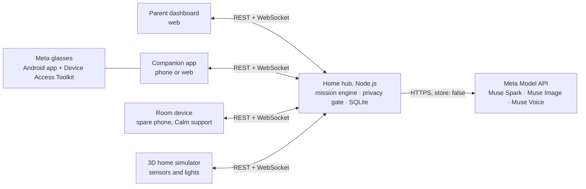

<p align="center">
  
</p>

<h3 align="center">An AI independence companion for autistic people and the caregivers who support them</h3>

<p align="center">
  Built for the Meta Global AI Developer Hackathon · Meta Muse models · Meta glasses
</p>

**Demo video:** _coming soon_

## Why Bhavya

Everyday routines, such as using the restroom, packing a bag or making breakfast, are made of many
small steps. Many autistic people do best with clear, visual, step-by-step support, but that support
usually means a caregiver standing next to them. Bhavya lets a caregiver teach a routine once. It
then gives calm, private guidance through Meta glasses or a phone, and steps back as the person
becomes more independent.

Bhavya is a routine helper. It is not a therapy or medical product.

## What it does

- **Teach a routine once.** Write it, say it or film it. Muse drafts the steps, a simpler hint for
  each step and picture cards. The caregiver reviews and approves every draft.
- **Step-by-step guidance.** Voice and pictures on the phone and through the glasses. In rooms where
  the camera is allowed, Muse checks each step; elsewhere the person taps **Done**.
- **Support that fades.** Reminders get lighter once a step is done alone three times, and come back
  when help is needed.
- **Ask by voice.** "I need the toilet" sets the current routine aside, starts the restroom routine
  and offers to continue the first one afterwards.
- **Routine suggestions from the glasses** (opt-in). Bhavya notices where the person is and asks
  before starting anything.
- **Calm support** (opt-in). A spare phone in a room notices when it stays very loud or there are
  clear signs of distress, and offers a quiet break with breathing and calm music.
- **Communication board.** Picture buttons for Yes, No, Toilet, Too loud and more, spoken aloud.
- **Privacy first.** The camera stays off in private rooms such as the bathroom, and frames are never
  stored.

## How it uses Meta AI

| Meta technology | What Bhavya uses it for |
|---|---|
| **Muse Spark** (`muse-spark-1.3`) | Turning text or a demo video into a routine, checking camera steps, understanding spoken requests, suggesting a routine from what the glasses see, and Calm support's distress check |
| **Muse Image** (`muse-image-1.0`) | Picture cards for each step and the communication board |
| **Muse Voice Transcribe** (`muse-voice-transcribe-1.0`) | Caregivers speaking a routine, and the **Talk** button |
| **SAM 3.1** (`sam-3.1`) | An object finder that highlights a step's object (built, switched off for now) |
| **Meta Wearables Device Access Toolkit** | The Android app streams the glasses camera; the Mock Device Kit stands in when no glasses are at hand |

All AI runs on Meta models through the Meta Model API; no other AI models are used. Muse answers in
strict JSON (structured output), which the hub validates before using. Spoken guidance uses the
device's built-in text-to-speech.

## Safety and privacy by design

- **The engine decides, Muse advises.** A deterministic mission engine changes steps, starts
  routines and switches lights. Muse only drafts, looks and listens.
- **Caregivers approve every AI draft.** Any edit sends a routine back to draft.
- **Private rooms stay private.** No camera checks happen in private rooms: the app stops the
  camera and the hub rejects frames.
- **Nothing is kept.** Frames and audio are never stored, Muse requests are sent with
  `store: false`, and the `-contributor` models are never used.
- **Muse looks at objects, places and task progress, not at the person.** The one exception is
  opt-in Calm support, which asks only whether clear signs of distress are visible. Rocking,
  hand-flapping and other repetitive movements are never counted, and no one is identified.
- **The person always chooses.** Suggestions and breaks are offers with **Yes** and **Not now**;
  **Help** and **Stop** always work.
- **Smart-home actions are an allowlist** (light on, light off) for the routine's room. There is no
  lock action, so a door is never locked automatically.
- **Progress measures support needed, not obedience.** No scores, points or stars.

## Architecture



```
shared/   Types and zod schemas shared by hub and web (missions, protocol, API)
hub/      Home hub: Fastify REST API, WebSocket device bridge, SQLite (node:sqlite)
  src/engine/    Mission state machine, prompt levels, timers, Calm support, smart-home actions
  src/muse/      Meta Model API client, prompts, JSON schemas
  src/missions/  Drafting, safety rules, picture cards
  src/http/      Routes, WebSocket bridge, error handling
  test/          Unit tests (vitest)
web/      Vite + React app
  src/pages/parent     Parent dashboard
  src/pages/child      Companion app (served at /child)
  src/pages/room       Room device for Calm support
  src/pages/simulator  3D home simulator
android/  Kotlin app for Meta glasses: hosts the companion app, adds the glasses camera and voice
```

## Run it locally

Requirements: Node.js 22.13 or newer, and a Meta Model API key.

```bash
npm install
cp .env.example .env      # then put your key in MODEL_API_KEY
npm run dev
```

Open <http://localhost:5173>. The home page links to:

- **Parent dashboard** (`/parent`): create, review and approve routines, follow progress, and set
  up the profile and rooms.
- **Companion app** (`/child`): the step player, communication board and break screen.
- **Room device** (`/room`): Calm support on a spare phone or laptop.
- **Home simulator** (`/simulator`): a 3D home that stands in for door sensors and smart lights,
  with the real companion app in a phone frame next to it.

Two demo routines are added on first start: _Using the restroom_ (private room, starts
automatically, camera off) and _Pack your school bag_ (living room, camera checks).

### Demo walkthrough

1. Open the simulator. The companion app runs in the phone on the right; tap **Start** in it
   (browsers only allow sound after a tap).
2. Walk the person into the **Restroom** (arrow keys, or click a room). The door sensor fires, the
   camera turns off, the light turns on and the routine starts in the phone. Tap **Done**, **Help**
   or **Break** to see each path.
3. Walk to the **Living room** and start _Pack your school bag_ in the phone. The camera opens and
   Muse Spark confirms each step.
4. During the bag routine, tap **Talk** and say "I need the toilet". The bag routine waits, the
   restroom routine starts, and when it ends the phone asks "Do you want to continue Pack your
   school bag?".
5. Watch help requests and progress arrive in the parent dashboard.

### Options

Set these in `.env` and restart the hub.

| Option | Values | What it does |
|---|---|---|
| `HUB_PORT` | `8787` (default) | The hub's port. Change it if Windows has reserved 8787. |
| `SIMULATOR` | `show` (default), `hide` | `hide` removes the simulator's link from the home page; `/simulator` still works. |
| `SIMULATOR_VIEW` | `both` (default), `3d`, `simple` | `both`: 3D with a **Simple view** button. `3d`: 3D only. `simple`: the button-based simulator only. |
| `GLASSES_SUGGESTIONS` | `on` (default), `off` | `off` turns off routine suggestions from the glasses for the whole hub; the parent setting is hidden. |
| `PRIVATE_PAUSE_MINUTES` | `10` (default), `1` to `60` | Minutes the glasses stop looking around after seeing a private place. Use `1` for demos. |
| `CALM_SUPPORT` | `on` (default), `off` | `off` turns off Calm support for the whole hub; its settings, room device page and simulator button are hidden. |
| `CAMERA_DEBUG` | `off` (default), `on` | For testing: shows what Muse saw in each glasses frame, step check and room check. |
| `LOG_LEVEL` | `info` (default), `debug` | `debug` logs every hub decision step by step: sensors, privacy, Muse answers, engine. |

Rooms are matched to hub rooms by id (`restroom`, `bedroom`, `living_room`, `kitchen`), so names,
privacy and lights follow the parent's settings.

### Using a phone

The companion app works on a phone on the same Wi-Fi, at `http://<computer-ip>:5173/child` (the hub
prints the address). Browsers only allow the **camera and microphone over HTTPS**, so for camera
steps on a phone start the dev server with HTTPS:

```bash
BHAVYA_HTTPS=1 npm run dev     # PowerShell: $env:BHAVYA_HTTPS=1; npm run dev
```

Then open `https://<computer-ip>:5173/child` and accept the self-signed certificate warning.

### Android app for the glasses

The [Android app](android/README.md) shows the companion app from the hub and connects Meta glasses
through the Meta Wearables Device Access Toolkit. Inside it, the companion app uses the glasses
camera and Android's voice instead of the browser's (`web/src/lib/native.ts`). Without glasses,
Meta's Mock Device Kit uses the phone camera as the glasses camera.

### Production build

```bash
npm run build     # builds the web app into web/dist
npm start         # the hub serves the API and the web app on http://localhost:8787
```

### Scripts

| Command | What it does |
|---|---|
| `npm run dev` | Hub (with reload) and the web app on port 5173 |
| `npm run check` | Type check, lint and unit tests |
| `npm test` | Unit tests only |
| `npm run format` | Format the code with Prettier |

## How the features work

### Talking to Bhavya

The person taps **Talk**, speaks, and taps again (it stops by itself after 10 seconds). Muse Voice
writes down the words and Muse Spark works out what they want: start or continue a routine, help,
a break, stop, or "I'm done". The engine then decides what to do. A clear request for another
routine sets the current one aside (only one waits at a time) and offers it again afterwards. A
request Muse is unsure about becomes a yes/no question, and anything else changes nothing. Audio is
never stored.

### Routine suggestions from the glasses

Off by default; a parent turns it on in **Profile & rooms**. While no routine is running, the
glasses take a look every 15 seconds and Muse Spark checks whether one of the approved routines in
a camera-OK room fits the place. Bhavya only asks ("Do you want to do Pack your school bag?") after
the same answer twice in a row, and never starts anything without a yes.

Limits:

- a routine the person says no to (or does not answer) is not suggested again for 15 minutes;
- at most 4 suggestions per hour;
- never in a known private room;
- if Muse sees a bathroom or a place to change, the glasses stop looking for 10 minutes.

Without door sensors the hub cannot know the room in advance, so that first private frame does
reach Muse (with `store: false`, never saved). Door sensors in private rooms avoid even that.

### Calm support

Off by default; a parent turns it on in **Profile & rooms**. A spare phone or laptop in a room
where the camera is allowed opens `/room` and picks its room. While the person is in that room it:

- measures loudness on the device (nothing is recorded) and reports it once a second, and
- if the parent also allows it, sends a burst of 4 photos every 20 seconds, which Muse Spark checks
  for clear signs of distress (crying, screaming, covering ears, hitting, curling up, agitated
  pacing). Harmless repetitive movements such as rocking or hand-flapping are never counted.

When it stays very loud for the chosen time, or distress is seen in two looks in a row, the person
is asked "Do you want a quiet break?" (the break screen with breathing and calm music), and the
parent gets a notification. During a routine it uses the routine's own break. The person can always
say "Not now". After an offer there is no new one for 5 minutes, or for 10 minutes after "Not now".
Private rooms are never watched. Saying "I need a break" with **Talk** also starts a quiet break.
For demos, the simulator's **Make it loud** button plays a room device hearing shouting.

### Object finder (switched off)

Highlighting a step's object with SAM 3.1 ("Where is the toothbrush?", "Photo from video") is still
in the code but switched off in `shared/src/features.ts` (`FEATURES.objectFinder`). While it is off,
the hub does not register its routes and the web and Android apps hide its controls.

## Status and roadmap

Built and tested against the live Meta Model API: the hub, the parent dashboard, the companion app,
the 3D home simulator and the Calm support room device. The Android glasses app runs on an Android
phone with Meta's Mock Device Kit.

Next:

- Show steps on the Meta Ray-Ban Display and confirm them with the glasses touchpad.
- Real door sensors and smart lights through Home Assistant.
- Run on Meta's open-weight models on the home hub, so nothing leaves the home.
- Switch the SAM 3.1 object finder back on.

## Built with

Node.js 22, Fastify, SQLite (`node:sqlite`), zod, React 18, Vite, three.js, Kotlin, Jetpack
Compose, and the Meta Wearables Device Access Toolkit.
